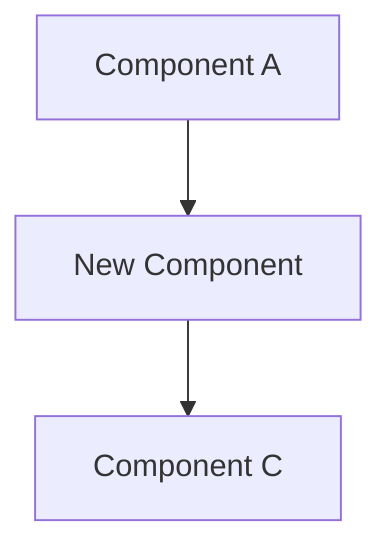

# Issues and MRs

## Architecture Diagrams

Every issue and MR description **must** include an architecture or flow diagram using Mermaid syntax. Choose the diagram type that best illustrates the change:

- **New feature / component** → `graph TD` or `graph LR` showing how the new piece fits into the existing system
- **Data flow / async process** → `sequenceDiagram` showing actors and message flow
- **State machine / lifecycle** → `stateDiagram-v2`
- **Database / data model** → `erDiagram`

Wrap diagrams in a fenced code block with the `mermaid` language tag:

````

````

Place the diagram in its own `## Architecture` section in the body, before the implementation details.

